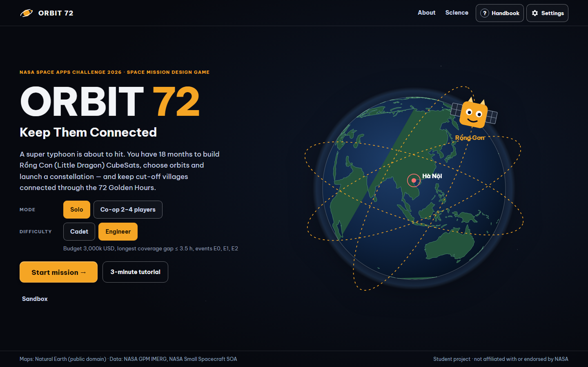
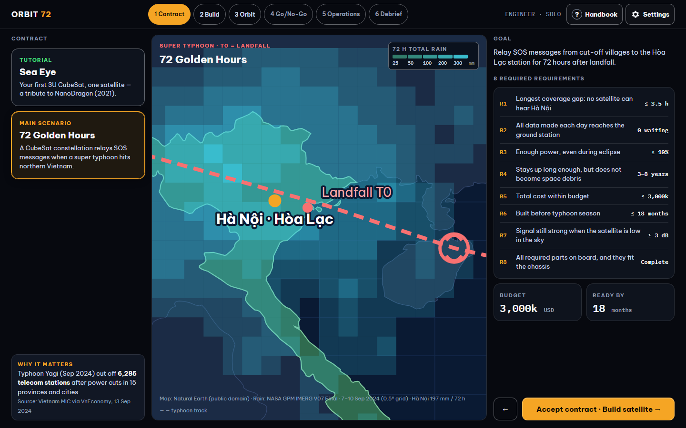
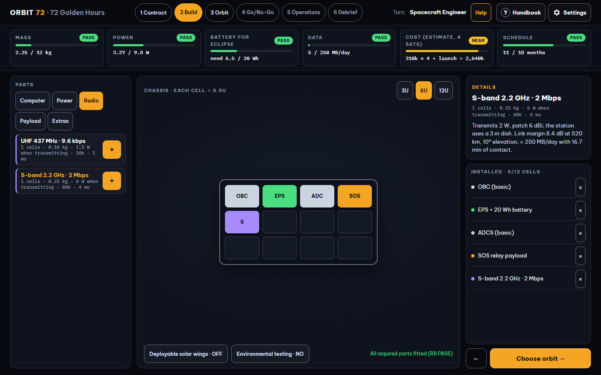
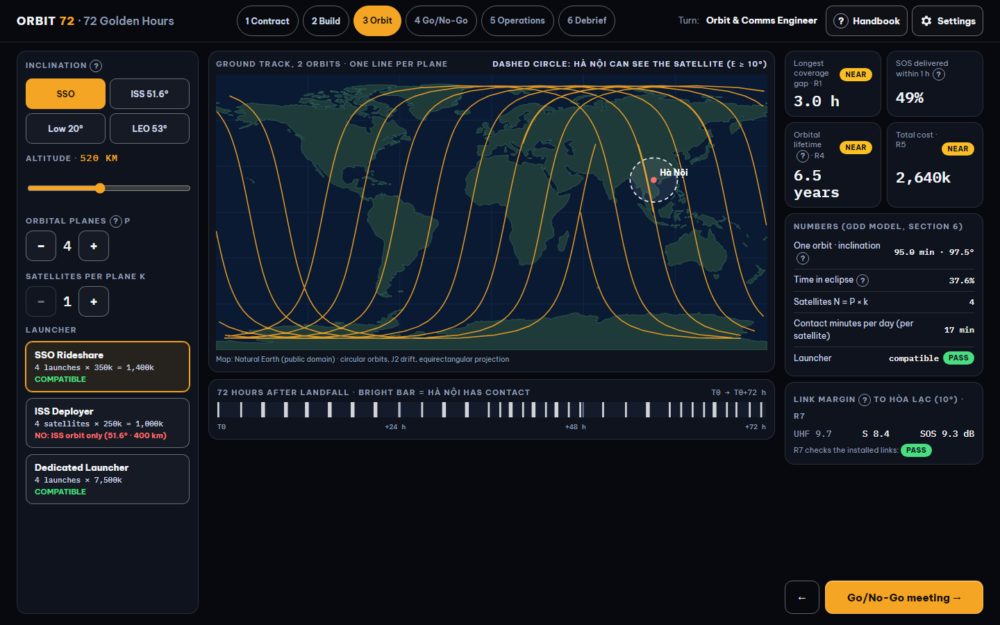
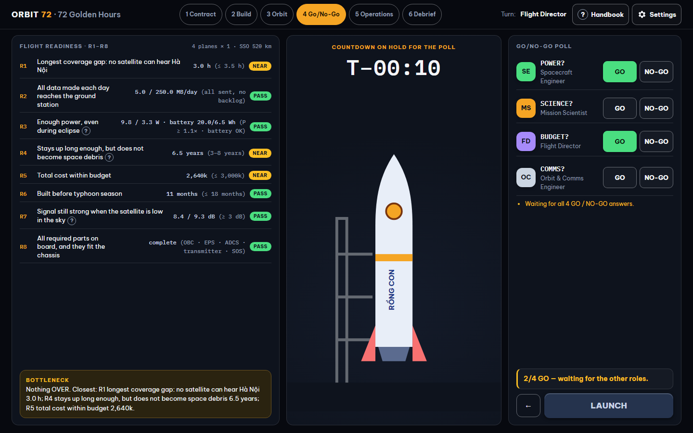
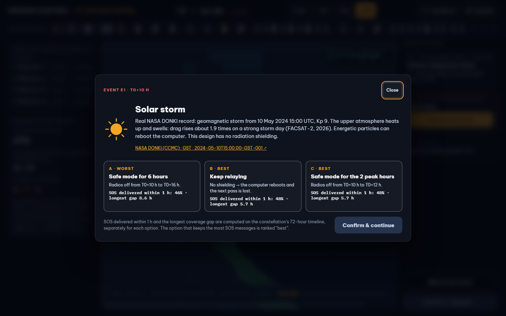
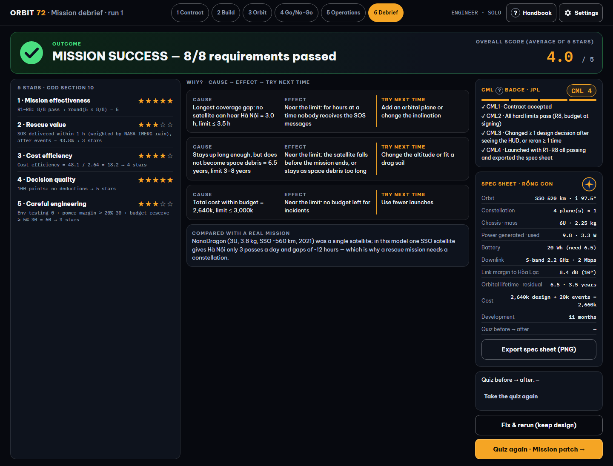
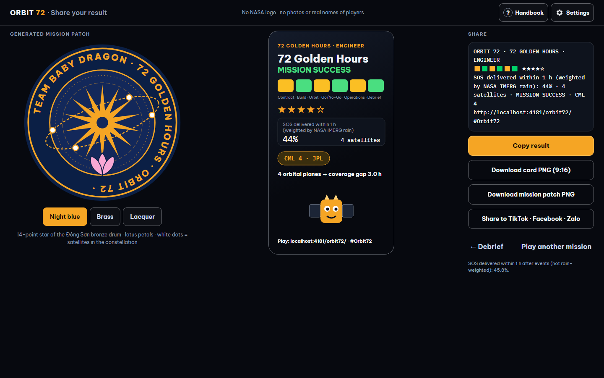

Play: https://holisurt.github.io/orbit72/ · About: https://holisurt.github.io/orbit72/about.html

# ORBIT 72: Keep Them Connected

ORBIT 72 (“Bắt Sóng Cứu Hộ”) is a browser game built for NASA Space Apps Challenge 2026 (Hanoi), in the Space Mission Design Game category. A Typhoon-Yagi-like super typhoon makes landfall over northern Vietnam (T0 = 2024-09-07 14:00 ICT). Players have 18 months to design, cost and launch a CubeSat constellation that relays SOS messages from cut-off villages to the Hòa Lạc ground station during the “72 Golden Hours”. The whole game is in English (since v1.3); place names such as Hà Nội, Hòa Lạc and Đông Sơn keep their Vietnamese spelling.

## How to play

1. **Contract** – accept the contract: eight requirements (R1 coverage gap, R2 data, R3 power, R4 orbital lifetime, R5 budget, R6 development time, R7 link margin, R8 mandatory subsystems).
2. **Build** – fit OBC, EPS, ADCS, radio and the SOS payload into a 3U/6U/12U CubeSat; a live HUD shows mass, power, battery, data, cost and time.
3. **Orbit** – choose inclination, altitude, planes × satellites and a rocket; see ground tracks, coverage gaps and link margins.
4. **Go/No-Go** – every role answers GO or NO-GO (a NO-GO needs an R code).
5. **Operations** – 72 hours after landfall with real NASA rain data and three event cards: E0 antenna deployment failure (only without environmental testing), E1 solar storm (real NASA DONKI geomagnetic-storm record) and E2 Hoa Lac station power cut.
6. **Debrief** – five stars, a why-chain, a spec sheet, a CML badge, a quiz before/after, and a shareable mission patch.

Solo or pass-the-device co-op (2–4 players), two difficulty levels (Cadet, Engineer), a 3-minute tutorial. Every technical term in the game has a “?” explainer that links to the in-game Handbook.

### Simplified in v1.1

For a high-school / first-year audience, v1.1 removed: the Director difficulty (launch failures, replacement launches, debris event E4, solar-max lifetimes), the daily mission, the camera payload and flood-imaging bonus, the cloud event E3, and the parts X-band, AIS receiver, edge-processing OBC, small electric thruster and precise ADCS. The remaining 9 parts (+ deployable wings), 3 events, 3 chassis sizes and 4 inclination presets keep every SPEC §10 reference value unchanged.

## Screenshots

Laptop, 1440 × 900, 100 % text (S1 solution: 6U with S-band, SSO 520 km, 4 planes × 1).

| | |
|---|---|
|  **Home** |  **Contract** |
|  **Build** |  **Orbit** |
|  **Go/No-Go** |  **Operations** |
|  **Debrief** |  **Share** |

## Science & validation

All constants come from [`docs/SPEC.md`](docs/SPEC.md) (derived from the GDD) and carry a provenance tag: [CT] physics, [NG] sourced, [GA] game assumption. Every [GA] assumption is listed in the in-game Handbook → Science tab.

**346 automated tests** (Vitest) cover the simulation and the screens. Reference values from SPEC §10 they check include:

| Quantity | Value |
|---|---|
| Orbital period at 520 km | 95.0 min |
| Eclipse fraction at 520 km | 37.6 % |
| SSO inclination at 520 km | 97.48° |
| Link margins at 520 km, 10° (UHF / S / SOS) | 9.7 / 8.4 / 9.3 dB |
| Longest coverage gap / SOS delivered within 1 h (P1h), SSO 520 km, 4 planes × 1 | 3.0 h / 49.1 % |
| Orbital lifetime at 520 km (6U, average Sun) | 6.5 years |
| Cost of the reference solution S1 | 2,640 kUSD |
| Event E1 (solar storm) / E2 (Hoa Lac station power cut) options A / B / C (S1) | 46 / 48 / 48 % · 49 / 45 / 48 % |
| Same, weighted by NASA IMERG rain (P1h_rain), S1 | 48.1 % (equals P1h when w = 1) |

## NASA data

- **NASA GPM IMERG V07 Final Run** (GPM_3IMERGHH, NASA GES DISC) — hourly rainfall over northern Vietnam, 2024-09-07 07:00 → 2024-09-10 07:00 UTC. Used for rain weights (the rain-weighted SOS score), the Brief 72 h rain map and the Ops hourly rain layer. DOI [10.5067/GPM/IMERG/3B-HH/07](https://doi.org/10.5067/GPM/IMERG/3B-HH/07) · [data.nasa.gov](https://data.nasa.gov/dataset/gpm-imerg-final-precipitation-l3-half-hourly-0-1-degree-x-0-1-degree-v07-gpm-3imerghh-at-g-fb698).
- **NASA DONKI** (CCMC) — geomagnetic storm record [2024-05-10T15:00:00-GST-001](https://ccmc.gsfc.nasa.gov/DONKI/view/GST/30693/-1) (Kp 9) on event card E1.
- **NASA Small Spacecraft State of the Art 2026** — reference ranges for component parameters.
- **Challenge resources** — mission segments from “Design and Develop Science Missions” and JPL Concept Maturity Levels (see [`data_prep/BTC_DATASET.md`](data_prep/BTC_DATASET.md)).

All data is pre-processed into static JSON under `public/data/`. The game makes no runtime network calls and stores progress only in the browser (localStorage).

## Run locally

Requires Node.js 20+.

```bash
npm install
npm run dev       # local dev server
npm test          # Vitest
npm run build     # production build to dist/
npm run preview   # serve the production build
```

Deployment: GitHub Actions → GitHub Pages on every push to `main` (`.github/workflows/deploy.yml`, tests must pass).

## Data preparation (`data_prep/`)

Python scripts rebuild the NASA JSON files; outputs are committed, credentials never are.

- `prepare_imerg.py` — downloads IMERG Final Run granules with `earthaccess`. Needs a NASA Earthdata login, given as environment variables `EARTHDATA_USERNAME` / `EARTHDATA_PASSWORD` (or `~/.netrc`).
- `fetch_donki.py` — queries DONKI month by month. Set `NASA_API_KEY` as an environment variable (falls back to `DEMO_KEY`, which is rate-limited).

See [`data_prep/README.md`](data_prep/README.md).

## Use of AI

Code, tests and documentation were drafted with Claude Code (Anthropic) and reviewed by the team and a mentor at every checkpoint. Each AI-assisted change is logged in [AI_USAGE.md](AI_USAGE.md).

## Credits

Data sources, challenge resources, references and fonts: [CREDITS.md](CREDITS.md).

## License

[MIT](LICENSE) © 2026 ORBIT 72 team.

## Disclaimer

ORBIT 72 is a student project. It is not affiliated with or endorsed by NASA and does not use NASA logos or insignia. Prices and some parameters are simplified game assumptions, not quotes or engineering data.
